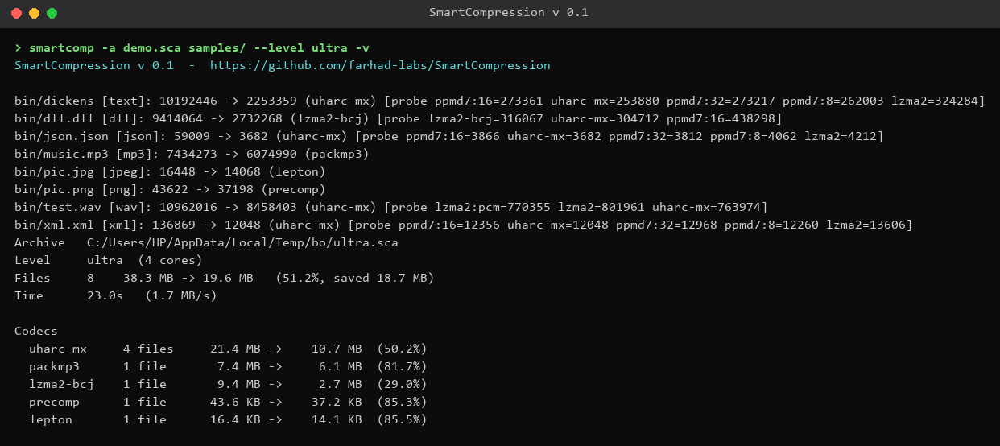
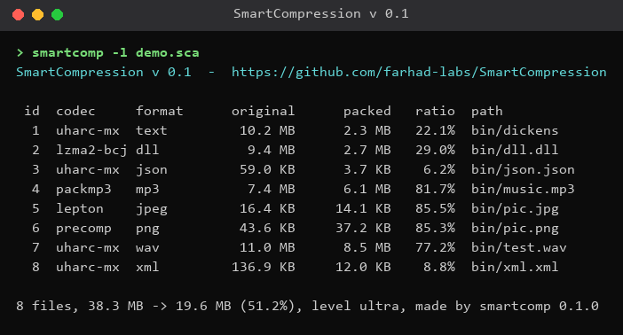
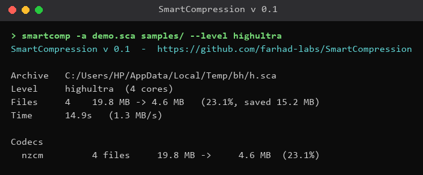
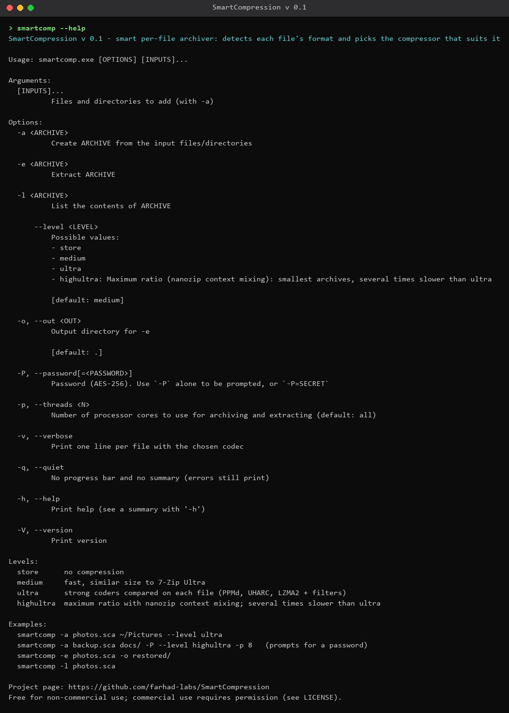

# SmartCompression v 0.1

**A smart per-file archiver.** SmartCompression looks at every file's real format (magic bytes, not the
extension), then picks the compressor that suits it best: PPMd/UHARC for text, LZMA2 + BCJ for
executables, Lepton for JPEG, packMP3 for MP3, Precomp for PNG/ZIP/PDF streams, and context mixing
for maximum ratio. Archives can be encrypted with AES-256-GCM, and every extraction is verified.

- Repository: <https://github.com/farhad-labs/SmartCompression>
- License: **free for non-commercial use; commercial use requires the author's permission** (see [License](#license))

## Screenshots

SmartCompression is a command-line program. These images are renderings of its real terminal output.

| Creating an archive (`--level ultra -v`) | Listing an archive (`-l`) |
|---|---|
|  |  |

| Maximum ratio (`--level highultra`) | `--help` |
|---|---|
|  |  |

## Requirements

To **build** (there are no prebuilt binaries yet):

| Requirement | Notes |
|---|---|
| Rust toolchain **1.85 or newer** | <https://rustup.rs> (needed by the bundled Lepton crate). On Windows use the **MSVC** toolchain: `rustup default stable-x86_64-pc-windows-msvc` |
| A C and C++17 compiler | Windows: Visual Studio Build Tools ("Desktop development with C++"); Linux: `gcc`/`g++` or `clang`; macOS: Xcode command-line tools |
| Git | to clone the repository |
| Internet access | the first build downloads the Rust crates from crates.io |

Everything else (zstd, brotli, LZMA SDK, Precomp, Lepton, packMP3, UHARC and NanoZip-CM engines) is in
`third_party/`, so no other library has to be installed. At run time the program has no dependencies.
The stronger levels (`ultra`, `highultra`) use more memory than `medium`; use `-p N` to limit the number of parallel workers.

Developed and tested on Windows 10 x64.

## Build

```sh
git clone https://github.com/farhad-labs/SmartCompression
cd SmartCompression
cargo build --release
```

The program is `target/release/smartcomp` (`smartcomp.exe` on Windows).

## Usage guide

```text
smartcomp -a ARCHIVE INPUT...   create an archive from files and/or folders
smartcomp -e ARCHIVE -o DIR     extract an archive into DIR
smartcomp -l ARCHIVE            list an archive's contents and the codec used for each file
```

| Option | Meaning |
|---|---|
| `--level store\|medium\|ultra\|highultra` | `store` = no compression; `medium` (default) = fast, about 7-Zip Ultra size; `ultra` = tries strong coders per file and keeps the best; `highultra` = context mixing, smallest but several times slower |
| `-P` / `-P=SECRET` | encrypt (AES-256-GCM, Argon2id key). `-P` alone prompts for the password; also needed with `-e`/`-l` |
| `-p N` | use N CPU cores (default: all) |
| `-o DIR` | output folder for `-e` (default: current folder) |
| `-v` | one line per file with the chosen codec and probe sizes |
| `-q` | no progress bar and no summary |
| `--help`, `--version` | help / version |

Examples:

```sh
smartcomp -a photos.sca ~/Pictures --level ultra
smartcomp -a backup.sca docs/ -P --level highultra -p 8    # prompts for a password
smartcomp -e photos.sca -o restored/
smartcomp -l photos.sca
```

Archives use the `.sca` extension. Original files are never modified.

## Benchmarks

Measured with this program on a sample of the [Silesia corpus](https://sun.aei.polsl.pl/~sdeor/index.php?page=silesia)
(8 files, 38.3 MB; round-trip verified byte-for-byte with `cmp`). Machine: Intel Core i5-6500 (4 cores),
8 GB RAM, Windows 10. Times are wall-clock for the whole 8-file run and will vary between machines.

| Level | Archive size | Ratio | Create | Extract |
|---|---:|---:|---:|---:|
| `medium` | 19.7 MB | 51.4% | 8.2 s | 4.1 s |
| `ultra` | 19.6 MB | 51.2% | 23.0 s | 17.1 s |

Per-file result at `ultra` (the codec is chosen automatically):

| File | Type | Original | Packed | Ratio | Codec |
|---|---|---:|---:|---:|---|
| dickens | text | 10.2 MB | 2.3 MB | 22.1% | uharc-mx |
| dll.dll | executable | 9.4 MB | 2.7 MB | 29.0% | lzma2-bcj |
| json.json | JSON | 59.0 KB | 3.7 KB | 6.2% | uharc-mx |
| xml.xml | XML | 136.9 KB | 12.0 KB | 8.8% | uharc-mx |
| test.wav | audio (PCM) | 11.0 MB | 8.5 MB | 77.2% | uharc-mx |
| music.mp3 | MP3 | 7.4 MB | 6.1 MB | 81.7% | packmp3 |
| pic.jpg | JPEG | 16.4 KB | 14.1 KB | 85.5% | lepton |
| pic.png | PNG | 43.6 KB | 37.2 KB | 85.3% | precomp |

`highultra` on `dickens`, `dll.dll`, `json.json`, `xml.xml` (19.8 MB): **4.6 MB (23.1%)** in 14.9 s.

Already-compressed formats (MP3, JPEG, PNG) are re-compressed losslessly, which is why they shrink at all.
You can repeat the runs with `tools/bench.sh <level> [input-dir]`.

## How it works

1. **Detect**: magic bytes (`formats.toml`) plus content refiners identify each file's format.
2. **Choose**: for ordinary data, a sample of the file is compressed with candidate codecs and the best one wins.
3. **Pack**: files are compressed in parallel and stored in one container with a manifest.
4. **Verify**: integrity is checked when extracting; encrypted archives are authenticated (AES-GCM).

## Tools and libraries used

SmartCompression is written in Rust and builds on these projects (full details and licenses in
[THIRD_PARTY_NOTICES.md](THIRD_PARTY_NOTICES.md)):

| Purpose | Project | License |
|---|---|---|
| LZMA2, PPMd7, BCJ/delta filters | LZMA SDK / 7-Zip by Igor Pavlov | public domain |
| zstd codec | Zstandard (Meta) | BSD-3-Clause |
| brotli codec | Brotli (Google) | MIT |
| JPEG recompression | Lepton (Microsoft, Rust port) | Apache-2.0 |
| MP3 recompression | packMP3 by Matthias Stirner (Rust port) | LGPL-3.0-or-later |
| PNG / ZIP / PDF stream recompression | Precomp (+ preflate, brunsli, zlib, bzip2, giflib, liblzma, packJPG) | Apache-2.0 and others |
| Context-mixing coder (`highultra`) | nanozip-re (reimplementation of NanoZip by Sami Runsas) | MIT |
| `uharc-mx` codec | UHARC 0.6b design by Uwe Herklotz; Rust implementation by farhad-labs | see notices |
| Rust crates | aes-gcm, argon2, blake3, clap, indicatif, rayon, rand, rpassword, serde, serde_json, toml, walkdir, anyhow, tempfile, cc | MIT / Apache-2.0 |

## License

SmartCompression is **free to use for non-commercial purposes** under the
[PolyForm Noncommercial License 1.0.0](LICENSE).

**If you want to use it commercially** (in a product, a paid service, or inside a company), you must
contact the author and obtain permission first: open an issue at
<https://github.com/farhad-labs/SmartCompression/issues>.

Third-party code in `third_party/` keeps its own licenses (see [THIRD_PARTY_NOTICES.md](THIRD_PARTY_NOTICES.md));
the non-commercial restriction applies only to SmartCompression's own code.

## Disclaimer

The software is provided "as is", without warranty. Keep a copy of important data until you have
verified the extracted files.
